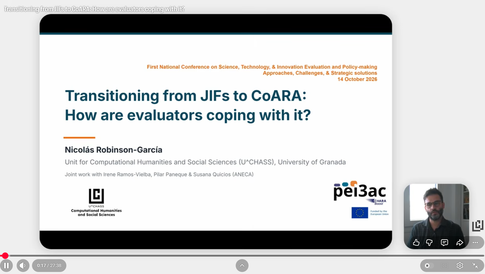

{fig-align="center" width="584"}

On October 14, 2026 I had the chance to present some of the findings of the PEI3AC Project at the First National Conference on Science, Technology, & Innovation Evaluation and Policy-making Approaches, Challenges, & Strategic solutions, organized online by Zoreh Zahedi. In this talk I provide a brief overview of the Spanish national evaluation system before digging into our study on evaluative practices of panel members of ANECA which we conducted last March.

::: bonus
In this talk I will provide a brief overview of the Spanish Research Assessment. I will then focus on the role of the National Accreditation Agency, ANECA, a body in charge of accrediting any individual who aims to become faculty at Spanish universities. After signing CoARA, ANECA introduced an important reform in 2024 in which it modified all its evaluation criteria to adapt it to CoARA's principles, especially those regarding the responsible use of metrics and the weight of qualitative expertise. In March 2026, led by ANECA, we experimented with members of the evaluation panel to have an insight on how these changes were being adopted by evaluators. We focused on three specific aspects: 1) changes on the CV format, moving from bullet lists to narrative Cvs; 2) narrative bibliometrics vs. traditional bibliometrics when arguing for the relevance and quality of publications; and, 3) unconscious biases. I will conclude by presenting some of the findings derived from these experiments.
:::

::: {.d-flex .gap-2}
[<i class="bi bi-download"></i> Download the slides](https://doi.org/10.5281/zenodo.23760395){.btn .btn-primary role="button" download=""}

[<i class="bi bi-play-circle"></i> Watch the video](https://www.youtube.com/watch?v=ENFusZVjUdg){.btn .btn-outline-primary role="button" target="_blank"}
:::
