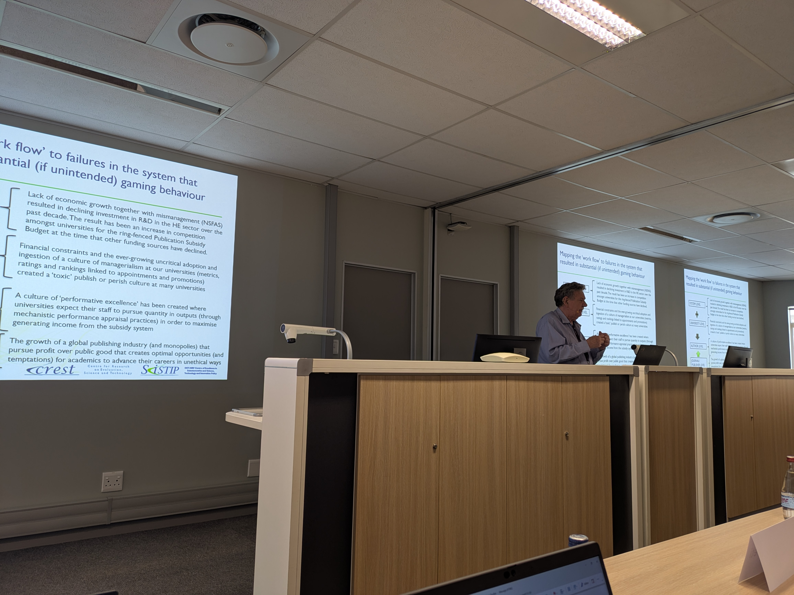{fig-align="center" width="610"}

A couple of weeks have gone by since I came back from South Africa. There I had the chance to participate at the **CREST Master Class in Research Evaluation** held between November 9 and 11, 2026. It was organised by the [Centre for Research on Evaluation, Science and Technology (CREST)](https://www0.sun.ac.za/crest/) from Stellenbosch University. The Master Class was organised and hosted by Johann Mouton and his team, who were wonderful hosts. In it Rodrigo Costas and I, along with Johan were the presenters. The Master Class was directed at staff from research offices at South African universities, a total of 80 participants.

In my case, I gave a talk on university rankings on Wednesday, which seems to be a big issue in South Africa as they are targeted by university administrators leading to frustration and futile policies. In the presentation I discussed how university rankings came to dominate the higher education landscape, how they are constructed and the methodological choices that influence the positioning of universities in them.Although at first they relied heavily on survey data, nowadays they are highly dependent on publication and citation data, derived in many cases from Clarivate’s Web of Science and Elsevier’s Scopus databases. This reliance as well as their combination with other non-bibliographic indicators (e.g., Awards or alumni data) introduce important methodological choices which have an enormous impact on their final lists but are quite controversial. I also illustrated how these decisions affect specific universities. Furthermore, we discussed how disciplinary specialization affects universities’ positioning.

::: text-center
[<i class="bi bi-folder2-open"></i> Link to slides in Zenodo](https://zenodo.org/records/24154790){.btn .btn-primary .btn-lg role="button" target="_blank"}
:::

Also some pics from Stellenbosch:

## Gallery

::: {layout-ncol="5"}
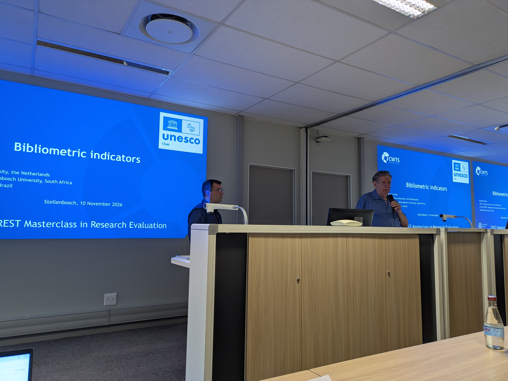{group="gallery"}

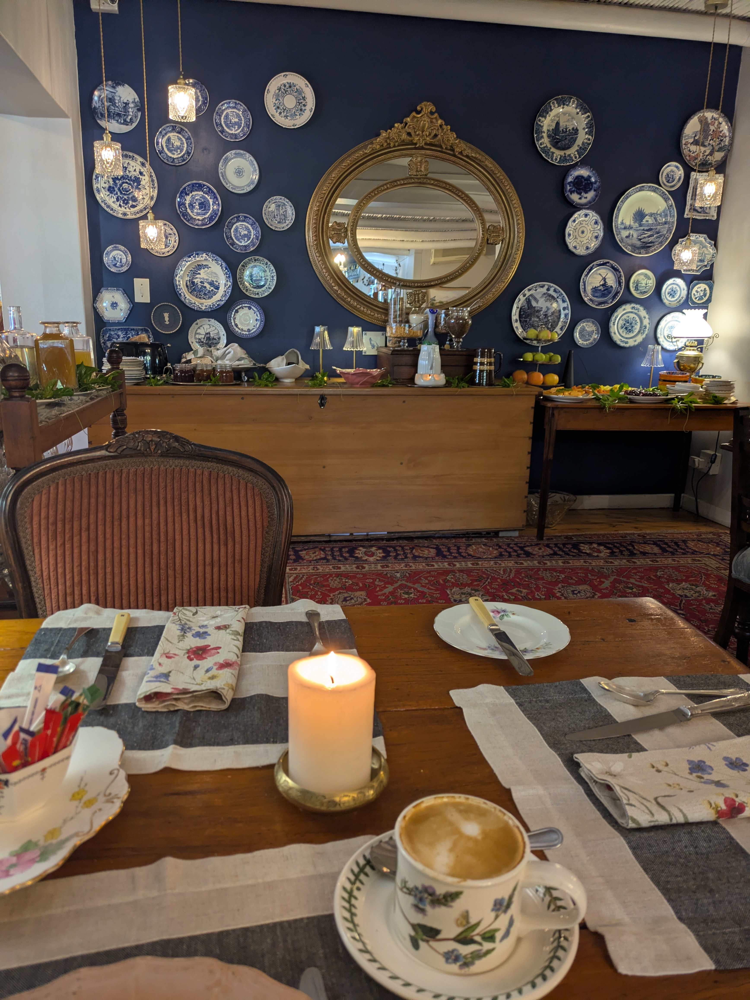{group="gallery"}

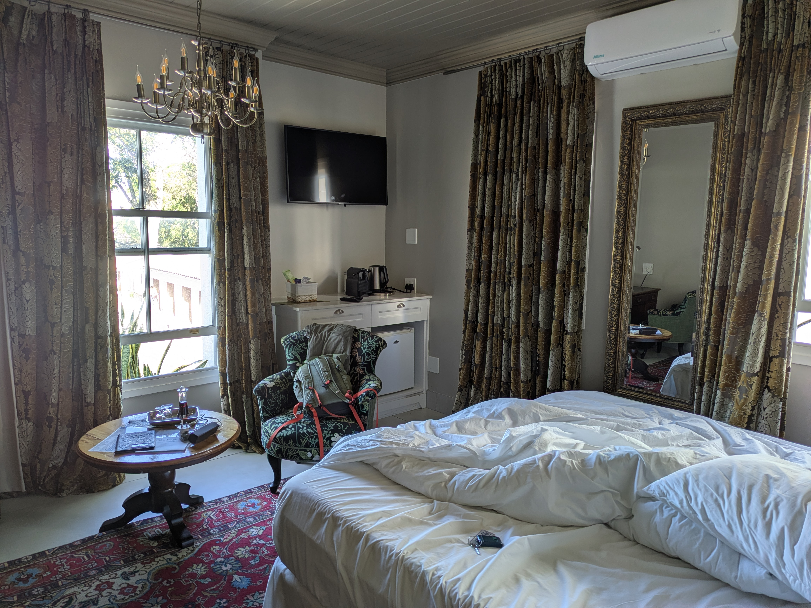{group="gallery"}

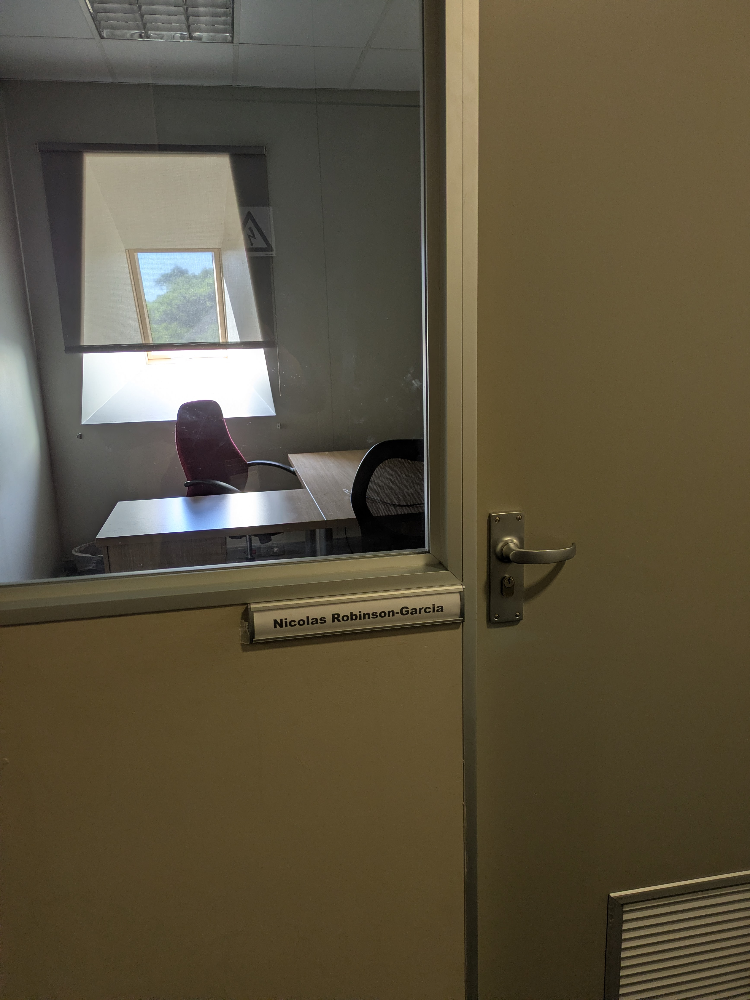{group="gallery"}

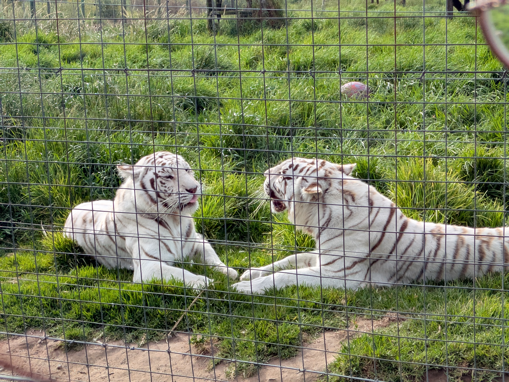{group="gallery"}

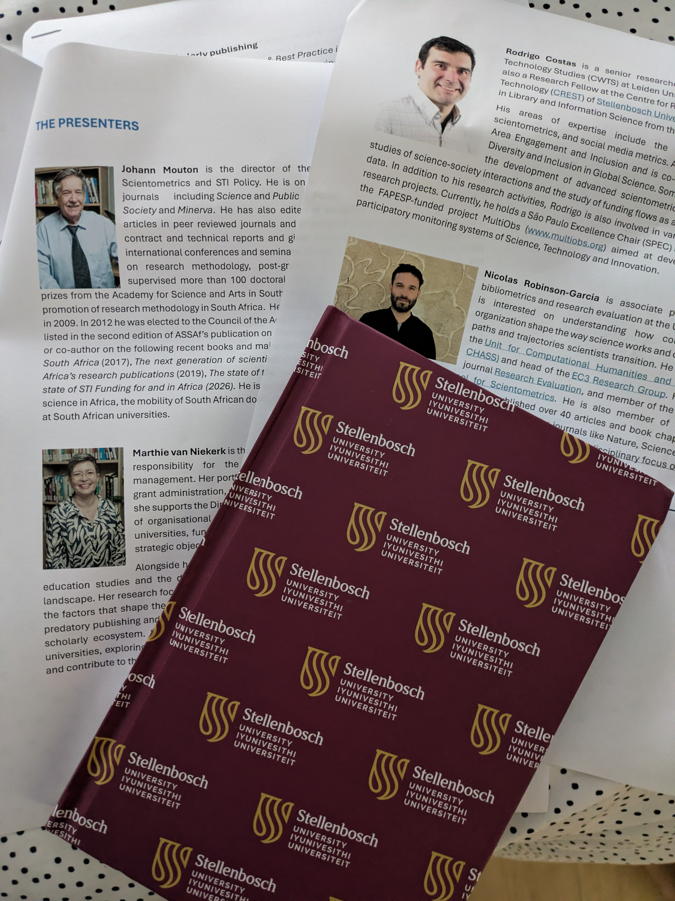{group="gallery"}

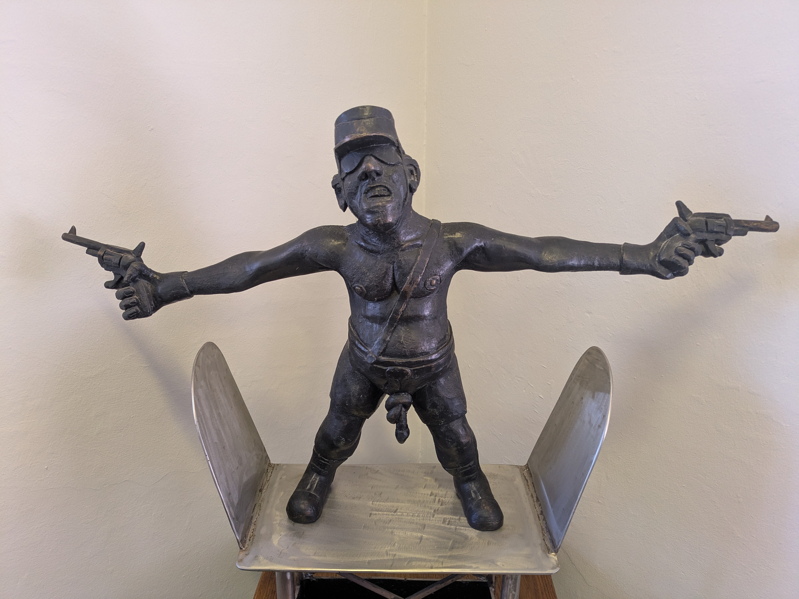{group="gallery"}

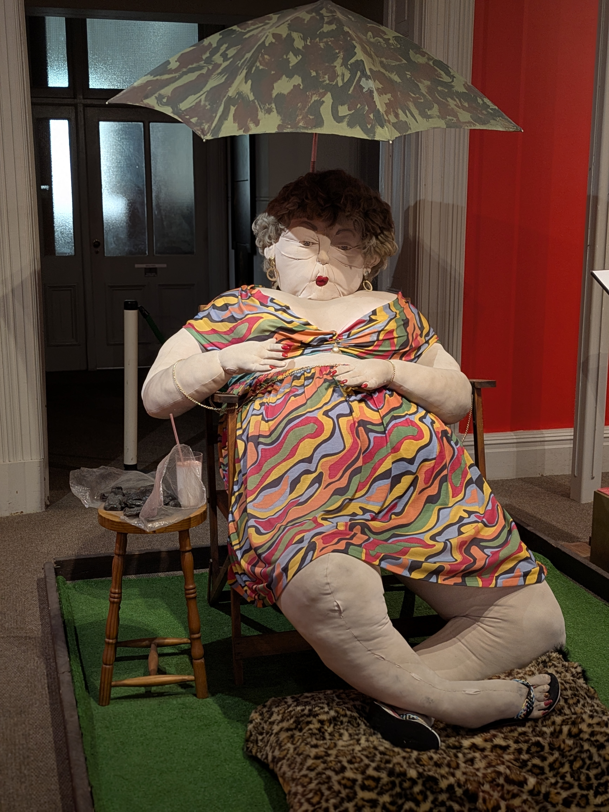{group="gallery"}

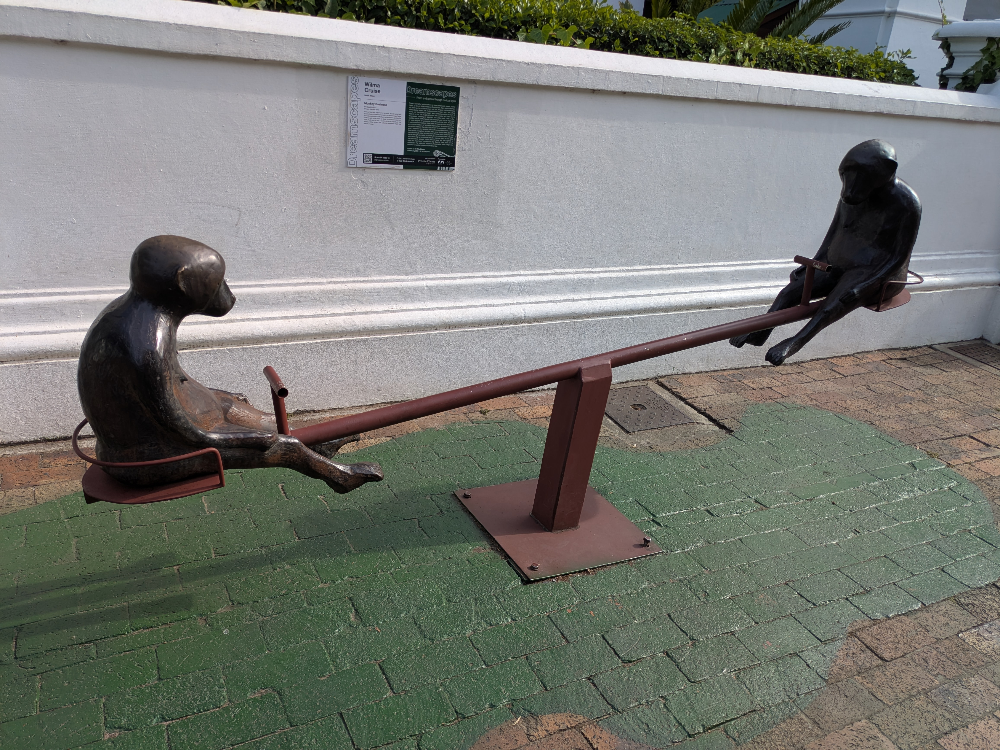{group="gallery"}

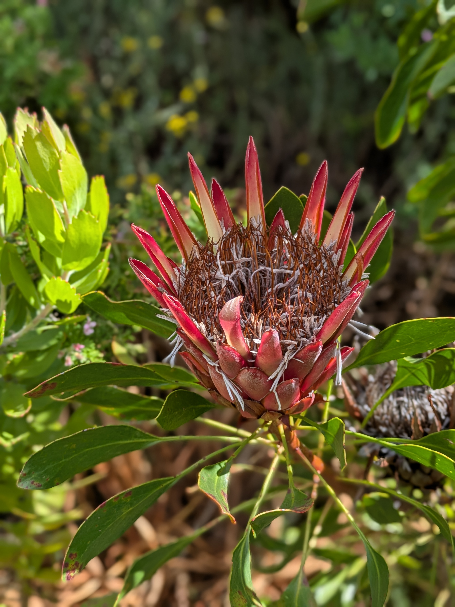{group="gallery"}
:::
